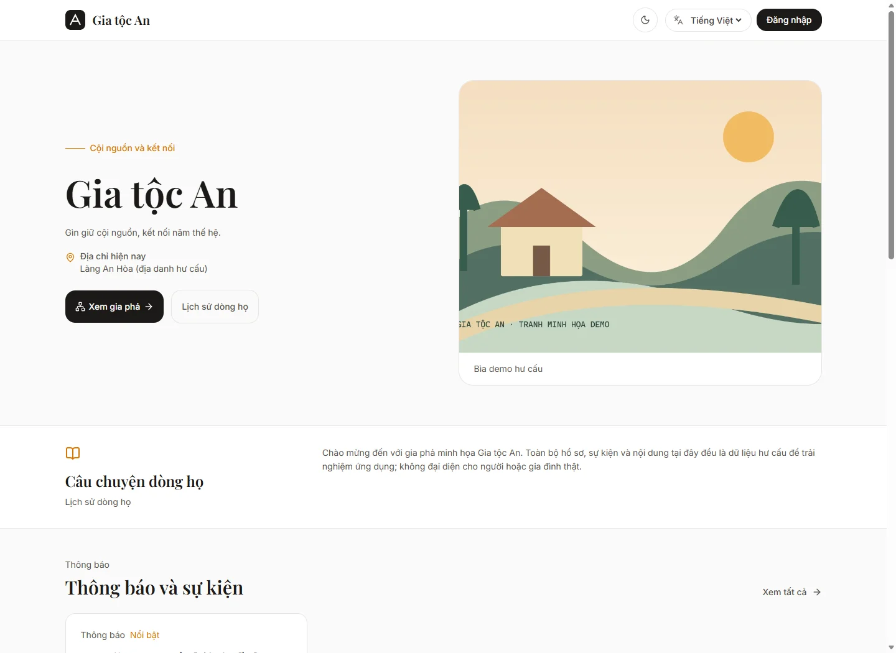
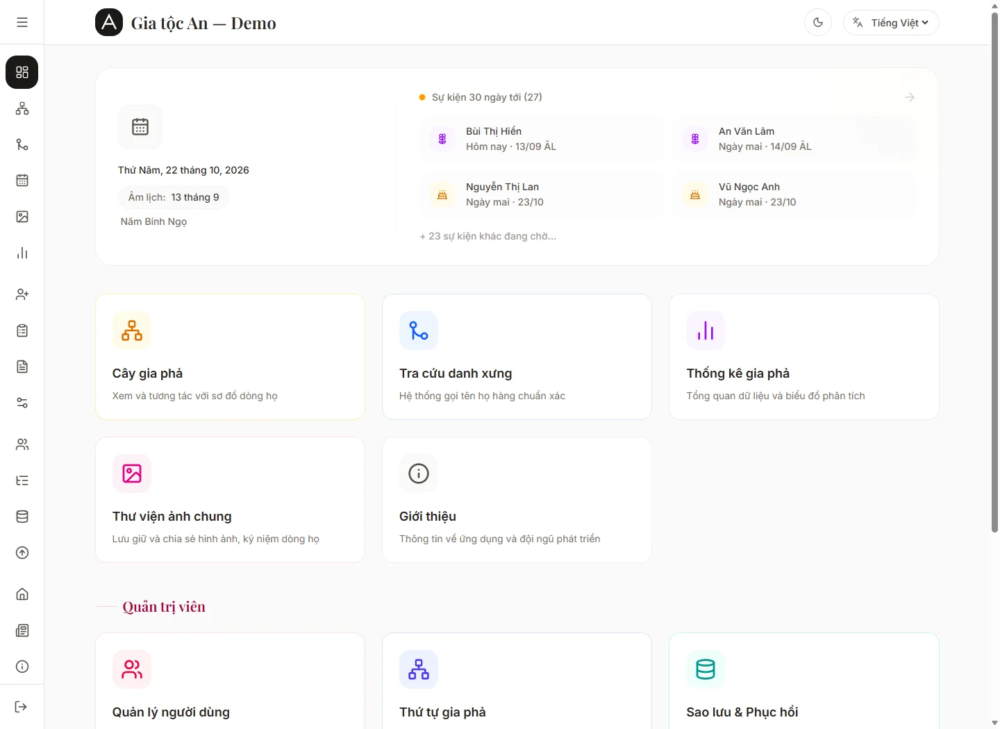
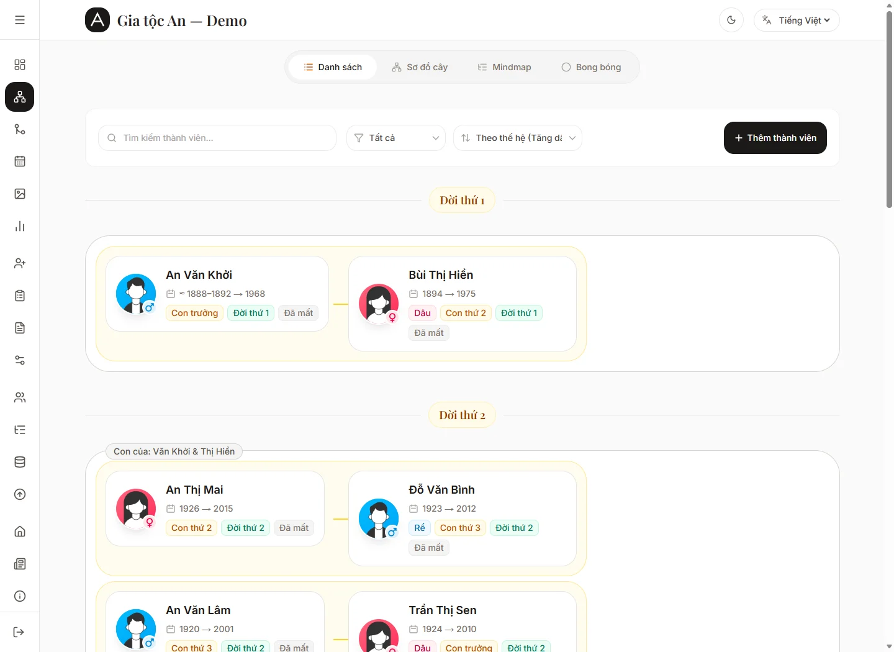
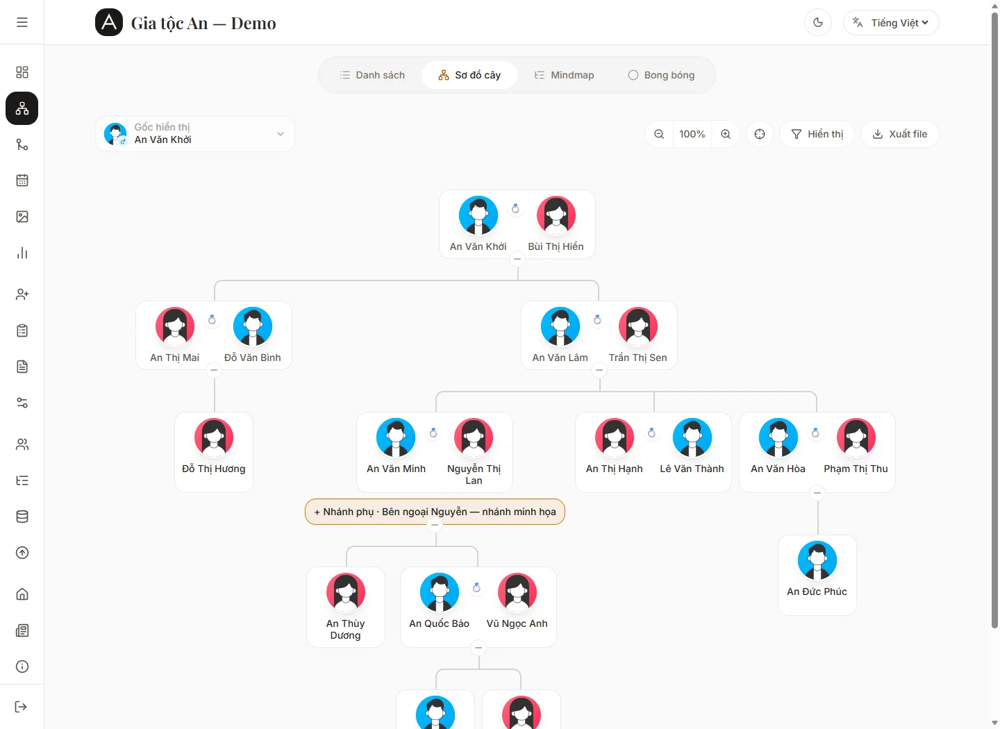
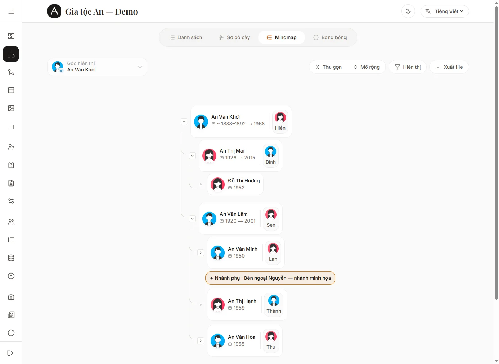
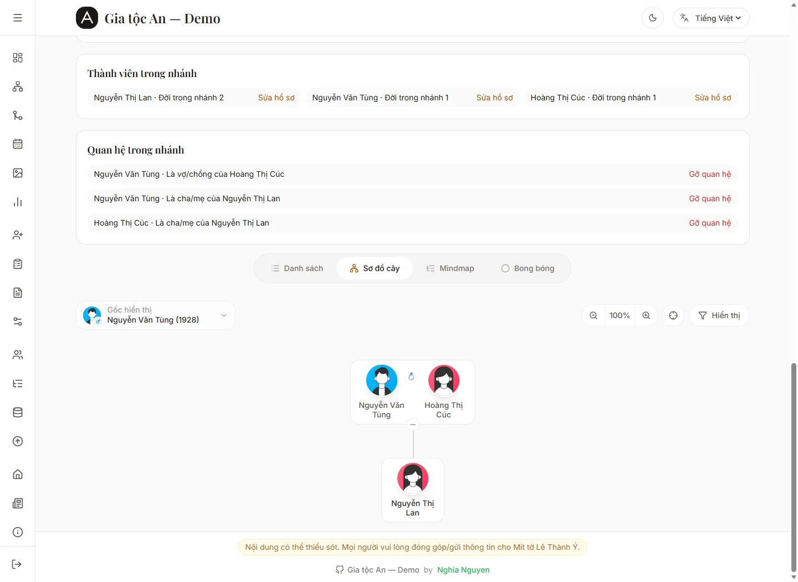
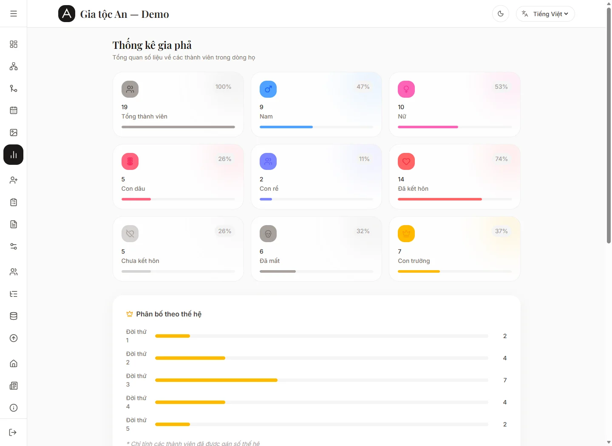
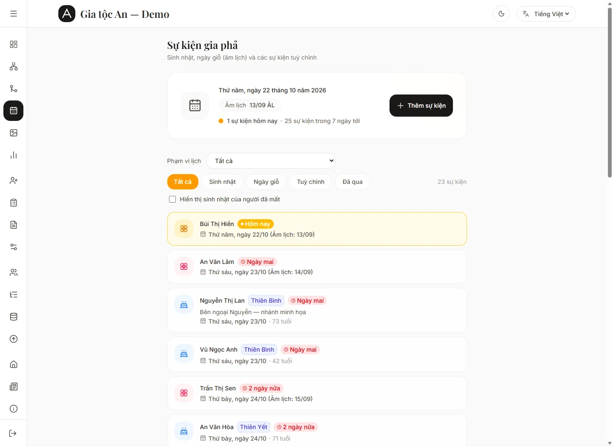
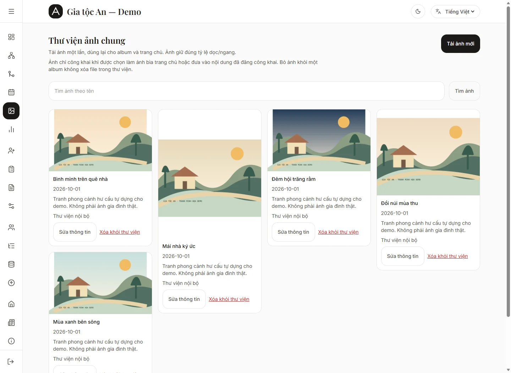
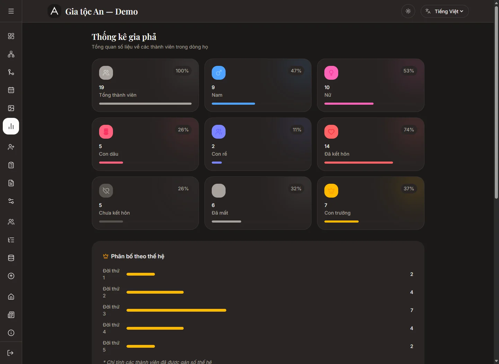

# Family Tree — Gia phả Việt Nam

Bản fork của [Gia Phả OS](https://github.com/homielab/giapha-os), dùng để quản lý hồ sơ, quan hệ và sinh hoạt dòng họ. Mỗi website dùng Supabase riêng cho dữ liệu, tài khoản và ảnh; gia đình tự quản lý quyền truy cập và việc triển khai.

Nhánh `multi-family-tree` hiện triển khai **giai đoạn 1: một deployment cho một gia tộc**, chọn cấu hình Git bằng `FAMILY_ID` khi build. Mỗi gia tộc có domain, Supabase và phiên bản triển khai riêng. Giai đoạn 2–3 về quản trị hệ thống và tự động hóa chưa được triển khai. Xem [bàn giao nhiều gia tộc](docs-multi-family/PHASE-1-HANDOFF.md).

## Demo và ảnh giao diện

Website Demo: **[demo-familytree.vercel.app](https://demo-familytree.vercel.app)**. Dữ liệu giới thiệu và ảnh chụp dành cho Demo sử dụng nhân vật hư cấu. Không nhập thông tin gia đình thật vào môi trường này. README không công bố tài khoản quản trị hoặc thông tin đăng nhập dùng chung.

Ảnh dưới đây minh họa giao diện với dữ liệu Demo; trạng thái dữ liệu và phiên bản trên website có thể khác thời điểm chụp.

Bộ mẫu gồm 21 hồ sơ hư cấu qua năm thế hệ, nhánh bên ngoại, lịch cúng, sự kiện, bài viết và album. Xem [cách tạo dữ liệu và chụp ảnh](docs/DEMO-HANDOFF.md).

| Trang chủ                                          | Tổng quan                                                  |
| -------------------------------------------------- | ---------------------------------------------------------- |
|  |  |

| Thành viên                                                  | Sơ đồ cây                                             |
| ----------------------------------------------------------- | ----------------------------------------------------- |
|  |  |

| Mindmap                                              | Nhánh gia đình bên dâu/rể                                |
| ---------------------------------------------------- | -------------------------------------------------------- |
|  |  |

| Thống kê                                              | Sự kiện                                                         |
| ----------------------------------------------------- | --------------------------------------------------------------- |
|  |  |

| Thư viện ảnh                                        | Chế độ tối                                               |
| --------------------------------------------------- | -------------------------------------------------------- |
|  |  |

[Xem giao diện điện thoại](docs/screenshots/demo/mobile.webp) · [Toàn bộ ảnh Demo](docs/screenshots/demo/)

Các màn hình chức năng khác: [chi tiết thành viên](docs/screenshots/demo/member-detail.webp), [sửa hồ sơ và khoảng năm](docs/screenshots/demo/member-form.webp), [tra cứu danh xưng](docs/screenshots/demo/kinship.webp), [biên tập nội dung](docs/screenshots/demo/content.webp), [thu thập và chờ duyệt](docs/screenshots/demo/intake.webp), [sao lưu](docs/screenshots/demo/data.webp), [kiểm tra nâng cấp](docs/screenshots/demo/upgrade.webp).

## Tính năng

- Hồ sơ thành viên, avatar có cắt ảnh, quan hệ cha mẹ–con ruột/con nuôi và vợ chồng; xem cây, mindmap và tìm danh xưng.
- Ngày sinh/ngày mất biết đầy đủ, biết một phần hoặc chỉ biết khoảng năm; khoảng năm ước tính được lưu riêng và hiển thị dấu `≈`.
- Thống kê, sự kiện, ngày giỗ và ngày cúng riêng theo âm/dương lịch, kể cả khi không nhớ ngày mất.
- Link thu thập thông tin gia đình theo nhánh; người thân gửi không cần đăng nhập, admin/editor duyệt trước khi đưa lên cây.
- Nhánh gia đình bên dâu/rể có gốc và đời riêng, dùng chung hồ sơ phù hợp và kiểm soát quyền theo quan hệ gia đình.
- Trang chủ với giới thiệu, thông báo, bài viết và album; quản lý bản nháp, hẹn giờ và phạm vi công khai/nội bộ.
- Thư viện ảnh chung, tải nhiều ảnh, dùng lại ảnh cho nội dung/album và xem ảnh bằng PhotoSwipe.
- Phân quyền admin/editor/member, liên kết tài khoản với hồ sơ; giao diện điện thoại, chế độ sáng/tối, tiếng Việt/Anh.
- Xuất/nhập cây bằng JSON; CSV/GEDCOM cho phạm vi được hỗ trợ. Xem giới hạn sao lưu bên dưới.

## Chạy local

Công nghệ chính: Next.js 16, React 19, TypeScript, Tailwind CSS 4, Supabase PostgreSQL/Auth/Storage và D3. Dự án dùng **Bun và `bun.lock`**; giữ bản vá trong `patches/` khi cài thư viện. Cần Node.js, Bun và project Supabase để đăng nhập/lưu dữ liệu; chưa có chế độ database offline hoàn chỉnh.

```powershell
bun install --frozen-lockfile
if (!(Test-Path .env.local)) { Copy-Item .env.example .env.local }
```

Tạo `families/<id>/config.json` và `assets/logo.svg` theo [hợp đồng cấu hình](docs-multi-family/PHASE-1-HANDOFF.md). Cấu hình phải có ID khớp tên thư mục, domain dự kiến và `supabaseProjectRef` của project riêng. Các cấu hình có sẵn đang gắn với môi trường của chủ dự án; khi tự triển khai, tạo cấu hình cho project của mình.

Điền `.env.local` theo [.env.example](.env.example):

| Biến                                           | Mục đích                                                                          |
| ---------------------------------------------- | --------------------------------------------------------------------------------- |
| `FAMILY_ID`                                    | Chọn `families/<id>/config.json` khi build; tên và logo lấy từ config             |
| `APP_URL`                                      | Local: `http://localhost:3000`; production: origin HTTPS khớp domain trong config |
| `NEXT_PUBLIC_SUPABASE_URL`                     | URL của đúng Supabase project đã khai báo trong config                            |
| `NEXT_PUBLIC_SUPABASE_PUBLISHABLE_DEFAULT_KEY` | Publishable key hoặc legacy anon key của project đó                               |
| `NEXT_PUBLIC_DISABLE_SSO`                      | Đặt `true` khi chưa cấu hình Google/Facebook                                      |
| `SUPABASE_SERVICE_ROLE_KEY`                    | Secret/service-role key phía server, cần cho luồng ảnh và chức năng admin client  |
| `SUPABASE_DB_URL`                              | Kết nối PostgreSQL có TLS, dùng khi chạy migration trong Dashboard                |
| `RESEND_API_KEY`, `RESEND_FROM_EMAIL`          | Tùy chọn: gửi thông báo email; để trống nếu chưa sử dụng                          |
| `ADMIN_NOTIFICATION_EMAIL`                     | Tùy chọn: người nhận thông báo; mặc định lấy các admin đang hoạt động             |
| `PRODUCT_RELEASE_MANIFEST_URL`                 | Tùy chọn: manifest phát hành sản phẩm HTTPS đã được người vận hành xác minh       |

Không đưa secret vào Git, ảnh chụp hoặc biến `NEXT_PUBLIC_*`. Không tự đặt `NEXT_PUBLIC_FAMILY_CONFIG`: build tạo biến này từ config đã kiểm tra. URL/key/SQL phải cùng project đã chọn; cấu hình thiếu hoặc sai bị từ chối, không tự chuyển sang Demo.

```powershell
bun dev
```

Mở `http://localhost:3000`. Dừng server bằng `Ctrl+C`. Sau khi sửa env, khởi động lại server.

Nếu có nhiều profile local, lưu riêng tại `families/<id>/.env.local` rồi dùng `bun run dev:family <id>`. Lệnh kiểm tra profile và khóa dev server trước khi copy về `.env.local` ở gốc; chỉ chạy một gia tộc mỗi lần. Dừng server và lưu thay đổi cần giữ ở file gốc về profile trước khi chuyển. Chi tiết tại [runbook local](docs/LOCAL-DEVELOPER-RUNBOOK.md).

## Khởi tạo database và tài khoản

1. Tạo Supabase project riêng, đối chiếu project ref với config và điền đúng URL/key.
2. Với **database mới**, mở `/setup`, copy toàn bộ SQL bundle và chạy trong SQL Editor của đúng project. Bundle gồm schema và migration theo thứ tự, ghi lịch sử cùng transaction.
3. Cấu hình Supabase Auth Site URL/redirect cho website, gồm `/auth/callback`; thêm localhost khi cần thử local. Nếu bật OAuth, cấu hình provider ở Supabase và callback của đúng Supabase project.
4. Đăng ký tài khoản chủ ứng dụng, xác minh email, mở [bootstrap-admin.sql](docs/bootstrap-admin.sql), thay email mẫu rồi chạy trong SQL Editor. Script chỉ cấp admin đầu tiên khi chưa có admin hoạt động. Đăng xuất rồi đăng nhập lại.
5. Admin duyệt các tài khoản tiếp theo trong **Quản lý người dùng**. Tài khoản mới là `member`, chưa hoạt động; người đăng ký đầu tiên không tự có quyền admin.

| Vai trò | Quyền chính                                                        |
| ------- | ------------------------------------------------------------------ |
| Admin   | Quản trị hệ thống, tài khoản và dữ liệu theo các luồng được hỗ trợ |
| Editor  | Biên soạn hồ sơ, quan hệ, sự kiện, nội dung và duyệt thu thập      |
| Member  | Xem dữ liệu theo quyền được cấp                                    |

Quyền xem/sửa nhánh phụ còn phụ thuộc liên kết tài khoản–hồ sơ và quan hệ gia đình. Xem [bàn giao nhánh phụ](docs/FAMILY-BRANCHES-HANDOFF.md).

## Triển khai và nâng cấp

Mỗi gia tộc dùng project Vercel và Supabase riêng. Chọn commit/tag đã duyệt, cấu hình biến môi trường riêng và chạy `bun run build`; start local production bằng `bun start`. Trên Vercel, `.env.local` của máy không được tự chuyển lên môi trường triển khai.

Đổi `FAMILY_ID`, domain hoặc biến public cần build/deploy lại; không dùng chung output `.next` cho hai gia tộc. Production cần `APP_URL` khớp domain trong config. Với Demo, domain cấu hình là `demo-familytree.vercel.app`. Không gắn mọi website vào cơ chế tự deploy mọi commit của nhánh phát triển.

**Deploy code không tự chạy migration Supabase.** Với database đã có dữ liệu, sao lưu, đọc ghi chú tương thích và xác định migration còn thiếu trước khi chạy. Không chạy lại toàn bộ `/setup` chỉ để xóa cảnh báo lịch sử. SQL đã chạy thủ công có thể chưa có trong `public.app_migrations`; tracker không thay thế đối chiếu schema thực tế.

Admin mở `/dashboard/upgrade` để kiểm tra nguồn phát hành và lịch sử migration. Nguồn phát hành dùng `PRODUCT_RELEASE_MANIFEST_URL`, không so với repo upstream; thiếu/lỗi manifest trả trạng thái chưa xác minh. Migration trong Dashboard cần `SUPABASE_DB_URL`; có thể dùng SQL Editor theo runbook nếu chưa cấu hình. Mỗi website giữ phiên bản độc lập; xem quy trình nâng cấp/rollback tại [handoff giai đoạn 1](docs-multi-family/PHASE-1-HANDOFF.md).

## Sao lưu và dữ liệu riêng tư

JSON v4 xuất phần cây theo quyền, gồm hồ sơ, quan hệ, chi tiết riêng, sự kiện và cấu trúc nhánh phụ. CSV/GEDCOM không giữ cấu trúc nhánh và bị chặn khi có nhánh phụ. Nhập cây là thao tác thay thế phần dữ liệu cây được hỗ trợ.

**File xuất cây không phải bản sao lưu toàn website.** File này không bao gồm toàn bộ CMS, thư viện media, intake, Auth, cấu hình dịch vụ hay bytes ảnh; URL ảnh không thay cho file ảnh. Chuyển sang project mới cần xác nhận lại liên kết tài khoản–hồ sơ. Sao lưu toàn môi trường cần database, Storage và cấu hình vận hành riêng, cùng lần khôi phục thử đã kiểm chứng. Xem [quy trình sao lưu/khôi phục](docs-multi-family/PHASE-1-HANDOFF.md#sao-lưu-và-kiểm-tra-khôi-phục-thủ-công).

Dữ liệu được lưu trong Supabase do người vận hành cấu hình. Người vận hành chịu trách nhiệm quản lý tài khoản, quyền, bản sao lưu và các dịch vụ ngoài được bật. Không đưa dữ liệu gia đình thật, file env, dump database hoặc thông tin đăng nhập vào repo.

## Phát triển và tài liệu

```powershell
bun node_modules/typescript/bin/tsc --noEmit
bun run lint
bun test tests
bun run build
```

Build cần cấu hình gia tộc hợp lệ. Test tự động/fixture không thay thế kiểm tra đăng nhập, quyền, upload và khôi phục trên môi trường thật.

- [Mục lục tài liệu](docs/README.md), [bối cảnh](docs/PROJECT_CONTEXT.md), [trạng thái và bằng chứng kiểm tra](docs/CURRENT_SNAPSHOT.md).
- [Hướng dẫn local](docs/LOCAL-DEVELOPER-RUNBOOK.md), [giai đoạn 1 nhiều gia tộc](docs-multi-family/PHASE-1-HANDOFF.md).
- [Khoảng năm](docs/YEAR-RANGES-HANDOFF.md), [thu thập/ngày cúng](docs/FAMILY-INTAKE-HANDOFF.md), [nhánh phụ](docs/FAMILY-BRANCHES-HANDOFF.md).
- [Trang chủ/CMS](docs/HOME-CONTENT-HANDOFF.md), [thư viện ảnh chung](docs/SHARED-MEDIA-HANDOFF.md), [quy chuẩn UI](DESIGN.md).

Đọc [AGENTS.md](AGENTS.md) trước khi sửa mã nguồn. Khi báo lỗi hoặc gửi PR, mô tả bước tái hiện và kiểm tra đã chạy; dùng dữ liệu giả và giữ thay đổi gọn, đúng phạm vi.

## Giấy phép và nguồn gốc

Dự án kế thừa mã nguồn [HomieLab/Gia Phả OS](https://github.com/homielab/giapha-os), phát hành theo [MIT License](LICENSE). Giữ nguyên thông báo bản quyền upstream: **Copyright (c) 2026 HomieLab**.
